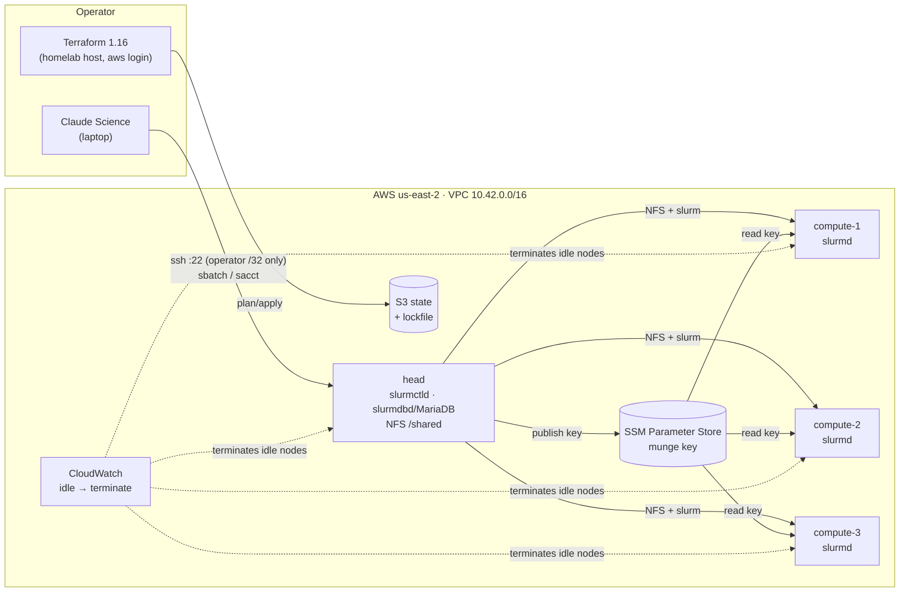

# ephemeral-hpc

[](https://github.com/nick-buser/ephemeral-hpc/actions/workflows/ci.yml)

A Slurm cluster on AWS that Terraform builds in minutes and that deletes
itself when it goes idle. [Claude Science](https://claude.com/docs/claude-science/remote-compute-clusters)
connects to it over SSH as a compute cluster and runs a two-stage distributed
workflow: ESM-2 protein embeddings sharded across the nodes, then a classifier
trained with multi-node PyTorch DistributedDataParallel.



## What's here

| Area | What it does | Where |
|---|---|---|
| Infrastructure as code | Two Terraform stacks. `bootstrap` creates the state bucket and a budget. `infra` builds the cluster on S3 remote state with S3-native locking. | [`bootstrap/`](bootstrap), [`infra/`](infra) |
| HPC scheduler | Slurm 23.11 with a controller, job accounting (slurmdbd on MariaDB, so `sacct` works) and configless compute nodes. Every node mounts the head node's NFS export at `/shared`. | [`infra/templates/`](infra/templates) |
| Distributed workload | Data-parallel ESM-2 embedding balanced by residue count across Slurm tasks, then a DDP classifier with rendezvous taken from Slurm's environment (gloo on CPU, NCCL on GPU). | [`workloads/protein/`](workloads/protein) |
| Agent-driven science | Claude Science submits, monitors and collects the jobs through its SSH/Slurm integration. The cluster ships the reviewed pipeline code to `/shared/opt/ehpc`, so the agent runs this repo's code. | [`docs/claude-science.md`](docs/claude-science.md) |
| Credentials and secrets | Nothing long-lived exists. Terraform runs on 12-hour `aws login` sessions. The munge key is generated on the head node at boot and reaches compute nodes through an SSM SecureString under per-role IAM. It never touches Terraform state, user data or git. | [ADR 0002](docs/adr/0002-no-long-lived-credentials.md), [ADR 0004](docs/adr/0004-cluster-secrets.md) |
| Network security | Nothing on the internet can open a connection to a node except SSH to the head node from the operator's /32. IMDSv2 is required, root volumes are encrypted, the default security group is emptied and VPC flow logs are on. | [`infra/network.tf`](infra/network.tf), [ADR 0003](docs/adr/0003-network.md) |
| Cost controls | Every node powers off after a TTL, and powering off terminates it. CloudWatch alarm actions terminate any node idle for an hour. Budget alerts fire at 50/80/100%. There is no NAT gateway, and the defaults are free-tier instance types. | [`infra/monitoring.tf`](infra/monitoring.tf), [`bootstrap/main.tf`](bootstrap/main.tf) |
| Testing and CI | `terraform test` checks the security and cost guardrails against a mocked AWS provider, so CI holds no cloud credentials. CI also runs tflint, a Trivy IaC scan, a full-history gitleaks scan, ruff, pytest and shellcheck. Actions are pinned to commit SHAs. | [`.github/workflows/ci.yml`](.github/workflows/ci.yml), [`infra/tests/`](infra/tests) |

## Results

First full run, 2026-10-15, driven end to end by Claude Science: it read
the host notes and pipeline code, wrote both job scripts, and submitted each
through an approval card. Three `m7i-flex.large` compute nodes, ESM-2 8M
(`esm2_t6_8M_UR50D`), 6,000 reviewed human proteins (2,476,635 residues).
The job scripts, logs, per-node timings, Slurm accounting and CloudWatch
metrics are in [`runs/2026-10-15-claude-science-cpu/`](runs/2026-10-15-claude-science-cpu/).

**Embedding throughput.** One 3-node allocation, with steps on 1, 2 and 3
nodes run one after another (Slurm job 1, 53 minutes).

| Nodes | Slowest node (s) | Residues/s | Speedup | Efficiency |
|---|---|---|---|---|
| 1 | 1,693.6 | 1,462 | 1.00× | 100% |
| 2 | 899.6 | 2,753 | 1.88× | 94% |
| 3 | 599.1 | 4,134 | 2.83× | 94% |

Sharding by residue count gave every node the same work: 825,545 residues
each at 3 nodes. The 6% gap is per-node speed. compute-2 was the slowest
node in both multi-node steps (1,377 residues/s, against 1,404–1,427 on the
others).

**Enzyme classifier.** 3-node DDP over gloo (Slurm job 2), trained on the
3-node embeddings for 30 epochs in 2.66 s.

| Held out, n = 1,205 | Classifier | Majority-class baseline |
|---|---|---|
| Accuracy | 0.904 | 0.756 |
| AUROC | 0.960 | 0.5 |

One seed. The split hashes accessions and is not homology-aware, so related
proteins can land on both sides and accuracy may be optimistic.

**What the accounting caught.** `sacct` showed every embedding step using
49–50% of its allocated CPU time. Inside a 2-CPU task, `nproc` was 1: the
job's cgroup held one of each node's two vCPUs. `slurm.conf` gave only
`CPUs=2`, and Slurm mapped that onto the instance's 1 core × 2 threads
wrongly. With the topology declared, the same node embedded a fixed
300-protein sample at 1,773 residues/s instead of 1,467 (+21%). The table
above was measured at one vCPU per node throughout, so its rows compare
fairly with each other but sit below what the hardware can do.

Billed cost will be added once AWS billing data catches up (it lags about a
day).

## Running it

[`docs/operating.md`](docs/operating.md) has the full sequence. In short:

```
scripts/operator-login.sh          # once per 12 h: browser sign-in, no keys
scripts/tf.sh bootstrap apply      # once per account
scripts/tf.sh infra apply          # ~6 min to a ready cluster
scripts/ssh-config.sh              # adds Host ehpc for ssh and Claude Science
scripts/tf.sh infra destroy        # or let the TTL / idle alarms do it
```

## Decisions

- [0001 Slurm on plain EC2 before Slinky on EKS](docs/adr/0001-slurm-on-ec2-first.md)
- [0002 No long-lived credentials, and why CI has none](docs/adr/0002-no-long-lived-credentials.md)
- [0003 One public subnet, no NAT, one ingress rule](docs/adr/0003-network.md)
- [0004 How the munge key reaches compute nodes](docs/adr/0004-cluster-secrets.md)
- [0005 CPU first: the account's GPU quota starts at zero](docs/adr/0005-cpu-first.md)

## Roadmap

- **GPU nodes.** Switch `compute_instance_type` to `g4dn.xlarge` once the
  quota increase lands, using an NVIDIA driver AMI and GRES. The DDP code
  already selects NCCL when CUDA is present.
- **Slinky on EKS.** Run the same Slurm workload on Kubernetes through
  SchedMD's slurm-operator, with EKS Pod Identity for AWS access.
- **Zero inbound ports.** Join the nodes to a Tailscale tailnet and drop the
  SSH rule.
- **Keyless CI applies.** Use GitHub OIDC federation if the account's
  `iam:*Provider*` restriction is lifted ([ADR 0002](docs/adr/0002-no-long-lived-credentials.md)).

[Work log](docs/worklog.md) · [MIT license](LICENSE)
