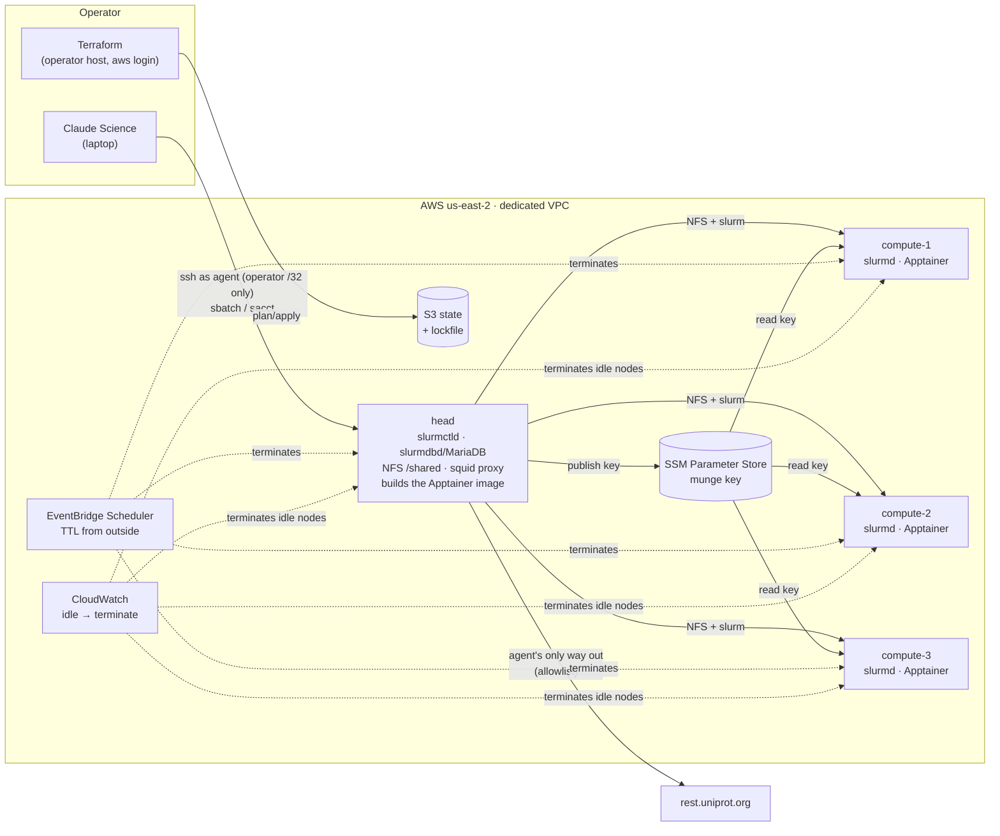

# ephemeral-hpc

[](https://github.com/nick-buser/ephemeral-hpc/actions/workflows/ci.yml)

A Slurm cluster on AWS that Terraform builds in minutes and that deletes
itself on a timer. [Claude Science](https://claude.com/docs/claude-science/remote-compute-clusters),
Anthropic's agent for scientific work, connects to it over SSH and runs a
two-stage distributed workflow: ESM-2 protein embeddings sharded across the
nodes, then a classifier trained with multi-node PyTorch
DistributedDataParallel. The agent runs as an unprivileged user, inside an
Apptainer image, behind an egress allowlist.

This is a personal project, built to learn and to show the work: how a
cluster like this is put together, how an AI agent can be given real compute
without being given the account, and what broke along the way. The
[work log](docs/worklog.md), the [design decisions](#decisions) and the
[isolation notes](docs/notes/agent-isolation.md) record the reasoning and
the mistakes as well as the result.



## What's here

| Area | What it does | Where |
|---|---|---|
| Infrastructure as code | Two Terraform stacks. `bootstrap` creates the state bucket and a budget. `infra` builds the cluster on S3 remote state with S3-native locking. | [`bootstrap/`](bootstrap), [`infra/`](infra) |
| HPC scheduler | Slurm 23.11 with a controller, job accounting (slurmdbd on MariaDB, so `sacct` works) and configless compute nodes whose CPU topology comes from the instance type. Every node mounts the head node's NFS export at `/shared`. | [`infra/templates/`](infra/templates) |
| Distributed workload | Data-parallel ESM-2 embedding, balanced by residue count across Slurm tasks; then a DDP classifier whose rendezvous comes from Slurm's environment (gloo on CPU, NCCL on GPU). | [`workloads/protein/`](workloads/protein) |
| Container runtime | Jobs run in an Apptainer image holding Python, the pinned packages and the model weights, with the base image pinned by digest. The head node builds it at boot from the definition in this repo. | [`workloads/container/esm.def`](workloads/container/esm.def), [ADR 0007](docs/adr/0007-apptainer.md) |
| Agent-driven science | Claude Science reads the host notes and the pipeline code, writes the job scripts, and submits each one through an approval card a human clicks. | [`docs/claude-science.md`](docs/claude-science.md) |
| Agent isolation | The agent logs in as `agent`: no sudo, no subordinate UIDs, and egress rules (nftables, matched on UID) that allow the cluster network and nothing else, so it cannot reach the instance's AWS credentials. Its only internet access is a proxy that allows UniProt and logs every request. A script proves each property on a live cluster. | [ADR 0006](docs/adr/0006-agent-sandbox.md), [notes](docs/notes/agent-isolation.md), [`sandbox-check.sh`](scripts/sandbox-check.sh) |
| Credentials and secrets | Nothing long-lived exists. Terraform runs on 12-hour `aws login` sessions. The munge key is generated on the head node at boot and reaches compute nodes through an SSM SecureString under per-role IAM. It never touches Terraform state, user data or git. | [ADR 0002](docs/adr/0002-no-long-lived-credentials.md), [ADR 0004](docs/adr/0004-cluster-secrets.md) |
| Network | Nothing on the internet can open a connection to a node except SSH to the head node from the operator's /32. IMDSv2 is required, root volumes are encrypted, the default security group is emptied and VPC flow logs are on. | [`infra/network.tf`](infra/network.tf), [ADR 0003](docs/adr/0003-network.md) |
| Cost controls | Every node powers off after a TTL, and powering off terminates it. EventBridge Scheduler terminates every node from outside 10 minutes later, in case the in-OS shutdown was cancelled. CloudWatch terminates nodes idle for two hours. Budget alerts at 50/80/100% of $20. No NAT gateway; free-tier instance types. | [`infra/ttl.tf`](infra/ttl.tf), [`infra/monitoring.tf`](infra/monitoring.tf) |
| Run records | `collect-run.sh` copies accounting, logs and metrics off a cluster before teardown, scrubs the account ID and public IPs, and refuses to finish if anything looks like a secret. | [`runs/`](runs), [`scripts/collect-run.sh`](scripts/collect-run.sh) |
| Testing and CI | `terraform test` checks the security and cost guardrails against a mocked AWS provider, so CI holds no cloud credentials. CI also runs tflint, a Trivy IaC scan, gitleaks on every pushed commit (and weekly over the full history), ruff, pytest and shellcheck. Actions are pinned to commit SHAs. | [`.github/workflows/ci.yml`](.github/workflows/ci.yml), [`infra/tests/`](infra/tests) |

## Results

The first full run (2026-10-15) was driven end to end by Claude Science on
three `m7i-flex.large` compute nodes: ESM-2 8M (`esm2_t6_8M_UR50D`) over
6,000 reviewed human proteins (2,476,635 residues). It ran before the
isolation work below existed, as the image's default user, outside any
container. The job scripts, logs, per-node timings, Slurm accounting and
CloudWatch metrics are in [`runs/2026-10-15-claude-science-cpu/`](runs/2026-10-15-claude-science-cpu/).

**Embedding throughput.** One 3-node allocation, with steps on 1, 2 and 3
nodes run one after another (53 minutes).

| Nodes | Slowest node (s) | Residues/s | Speedup | Efficiency |
|---|---|---|---|---|
| 1 | 1,693.6 | 1,462 | 1.00× | 100% |
| 2 | 899.6 | 2,753 | 1.88× | 94% |
| 3 | 599.1 | 4,134 | 2.83× | 94% |

Sharding by residue count gave every node the same work: 825,545 residues
each at 3 nodes. The 6% gap is per-node speed. compute-2 was the slowest
node in both multi-node steps (1,377 residues/s, against 1,404–1,427 on the
others).

**Enzyme classifier.** 3-node DDP over gloo, trained on the 3-node
embeddings for 30 epochs in 2.66 s.

| Held out, n = 1,205 | Classifier | Majority-class baseline |
|---|---|---|
| Accuracy | 0.904 | 0.756 |
| AUROC | 0.960 | 0.5 |

One seed. The split hashes accessions and is not homology-aware, so related
proteins can land on both sides and accuracy may be optimistic.

**What the accounting caught.** `sacct` showed every embedding step using
49–50% of its allocated CPU time. Inside a 2-CPU task, `nproc` was 1: the
job's cgroup held one of each node's two vCPUs, because `slurm.conf` gave
only `CPUs=2` and Slurm mapped that onto the instance's 1 core × 2 threads
wrongly. With the topology declared, the same node embedded a fixed
300-protein sample at 1,773 residues/s instead of 1,467 (+21%), and
embedding steps now use about 90% of their allocation. The table above was
measured at one vCPU per node throughout, so its rows compare fairly with
each other but sit below what the hardware can do.

**Isolation, checked on clusters built from code.** `sandbox-check.sh`
logs in as the agent and tests every property in the table above, on the
head node and through Slurm on each compute node, inside and outside the
container. [`runs/2026-10-16-isolation/`](runs/2026-10-16-isolation/) has
the first full check (53 passes) and the job scripts run as the agent inside
the container. [`runs/2026-10-16-isolation-after-review/`](runs/2026-10-16-isolation-after-review/)
is the check after the review's fixes: 59 passes; the EventBridge check
could not run because the operator's AWS session had expired. The same node
and data embedded at 1,795.6 residues/s inside the container and 1,773.2 on
the host.

Billed cost will be added once AWS billing data catches up.

## Where the isolation stops

The agent is contained by ordinary Linux and AWS controls, not by a sandbox
runtime. These limits are known and accepted for public data on a
disposable cluster:

- The agent shares each node's kernel. A kernel exploit would give it root
  on that node, still inside its own VM, VPC and narrow instance roles.
- DNS lookups go through the node's resolver, so data could leave encoded
  in queries.
- Nothing forces a job into the container; it only makes that the easy path.
- Compute nodes keep public IPs so system services can install packages at
  boot; the agent's own traffic cannot use them.

An independent review before publication found a real hole: the agent
could map itself to other host UIDs through Apptainer's `--fakeroot` and
leave the UID-matched egress rules. It is closed in three layers and
written up, with nineteen other findings, in the
[isolation notes](docs/notes/agent-isolation.md).

## How it was built

In about eleven hours of commits across 2026-10-15 and 2026-10-16, all on
`main`. The [work log](docs/worklog.md) has the timeline: scoping against
the account's constraints, the first deploy, two clusters lost to the idle
alarm while an agent waited for approval, the first Claude Science run, then
the isolation work and the review. Commit messages carry the findings as
they happened.

## Running it

[`docs/operating.md`](docs/operating.md) has the full sequence. In short:

```
scripts/operator-login.sh          # once per 12 h: browser sign-in, no keys
scripts/tf.sh bootstrap apply      # once per account
scripts/tf.sh infra apply          # ~1 min, then ~17 min of node boot
scripts/ssh-config.sh              # Host ehpc (agent) and ehpc-admin (operator)
scripts/sandbox-check.sh           # prove the isolation on the live cluster
scripts/collect-run.sh <name>      # keep the record before teardown
scripts/tf.sh infra destroy        # or let the TTLs and idle alarms do it
```

## Decisions

- [0001 Slurm on plain EC2 before Slinky on EKS](docs/adr/0001-slurm-on-ec2-first.md)
- [0002 No long-lived credentials, and why CI has none](docs/adr/0002-no-long-lived-credentials.md)
- [0003 One public subnet, no NAT, one ingress rule](docs/adr/0003-network.md)
- [0004 How the munge key reaches compute nodes](docs/adr/0004-cluster-secrets.md)
- [0005 CPU first: the account's GPU quota starts at zero](docs/adr/0005-cpu-first.md)
- [0006 What the agent can do on the cluster](docs/adr/0006-agent-sandbox.md)
- [0007 Jobs run inside an Apptainer image](docs/adr/0007-apptainer.md)

## Roadmap

- **Observability.** An OpenTelemetry collector on every node (host
  metrics, Slurm events, logs) and per-step training telemetry, then the
  Claude Science run again on the isolated cluster.
- **Build the image once.** Build and sign it in CI and pull it by digest,
  instead of building on every head node.
- **GPU nodes.** Switch `compute_instance_type` to a `g4dn` once the quota
  increase lands. The DDP code already selects NCCL when CUDA is present.
- **Compute nodes off the internet**, and the proxy checking TLS server
  names so a shared-CDN host could be allowlisted safely.
- **Slinky on EKS.** The same Slurm workload on Kubernetes through SchedMD's
  slurm-operator.

[Work log](docs/worklog.md) · [Isolation notes](docs/notes/agent-isolation.md) · [MIT license](LICENSE)
